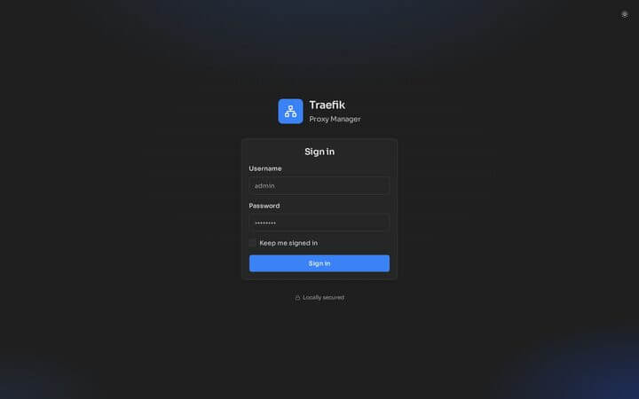
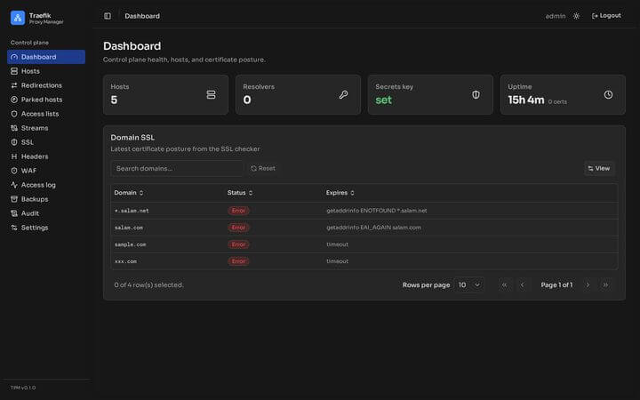
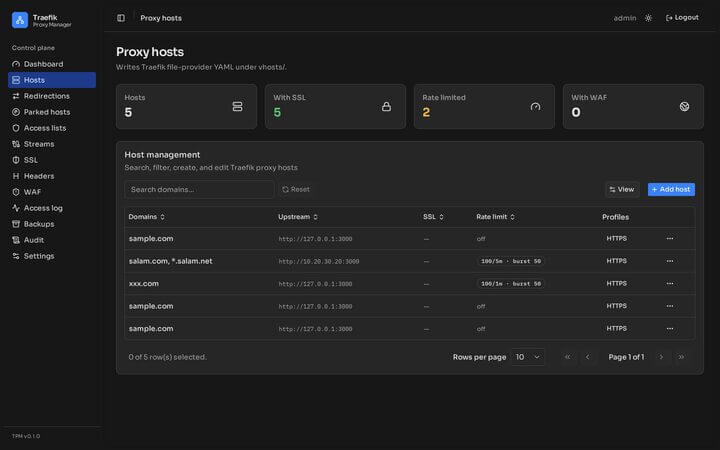
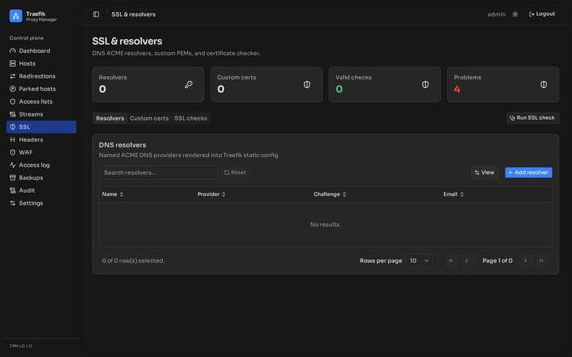

<div align="center">
  
  <h1>Traefik Proxy Manager</h1>
  <p>
    <strong>Single-user control plane for <a href="https://traefik.io/">Traefik</a></strong><br />
    Desired state in SQLite &rarr; generated YAML &rarr; Traefik file provider
  </p>

  <p>
    <a href="https://github.com/ariadata/traefik-proxy-manager/pkgs/container/traefik-proxy-manager"></a>
    <a href="LICENSE"></a>
    <a href=".nvmrc"></a>
  </p>

  <p>
    <a href="#features">Features</a> &bull;
    <a href="#screenshots">Screenshots</a> &bull;
    <a href="#quick-start">Quick Start</a> &bull;
    <a href="#configuration">Configuration</a> &bull;
    <a href="#documentation">Documentation</a>
  </p>
</div>

---

## Features

| Module | Capabilities |
| :--- | :--- |
| **Proxy Hosts** | Domain-to-upstream routing, forced HTTPS, ACME or custom certificates |
| **SSL Management** | ACME resolvers (`HTTP-01` / `DNS-01`), PEM uploads, certificate expiry checker |
| **Access Lists** | IP allow/deny rules combined with BasicAuth |
| **Redirects & Parked Hosts** | Custom HTTP redirections and static parked pages |
| **Headers & Lean WAF** | Reusable header packs, IP/bot/path blocking rules, per-host rate limiting |
| **TCP / UDP Streams** | Configurable entry ports for raw TCP and UDP traffic |
| **Operations** | Access logs, audit logs, and one-click backup/restore |

See [docs/FEATURES.md](docs/FEATURES.md) for the complete feature reference.

## Screenshots

<table>
  <tr>
    <td align="center">
      <a href="images/01-sign-in.png"></a><br />
      <strong>Sign in</strong>
    </td>
    <td align="center">
      <a href="images/02-dashboard.png"></a><br />
      <strong>Dashboard</strong>
    </td>
  </tr>
  <tr>
    <td align="center">
      <a href="images/03-hosts.png"></a><br />
      <strong>Proxy hosts</strong>
    </td>
    <td align="center">
      <a href="images/04-ssl.png"></a><br />
      <strong>SSL &amp; resolvers</strong>
    </td>
  </tr>
</table>

## Quick Start

Deploy using the lean **`production`** branch (includes Compose, environment template, and data directories only, pulling the prebuilt GHCR image):

```bash
git clone -b production --single-branch --depth 1 \
  https://github.com/ariadata/traefik-proxy-manager.git
cd traefik-proxy-manager

cp example.env .env
# Generate a secret key and set TPM_SECRETS_KEY in .env:
# openssl rand -hex 32

./init.sh
docker compose pull    # ghcr.io/ariadata/traefik-proxy-manager:latest
docker compose up -d
```

Panel: `http://127.0.0.1:8080` (see `DC_TPM_HTTP_PORT` in `.env`).

### Build from source (`main`)

```bash
git clone https://github.com/ariadata/traefik-proxy-manager.git
cd traefik-proxy-manager
cp example.env .env
make init && make compose-up
```

## Configuration

Copy [`example.env`](example.env) → `.env`.

| Variable | Purpose |
| :--- | :--- |
| `TPM_SECRETS_KEY` | Encrypts DNS / BasicAuth secrets at rest |
| `DC_TPM_HTTP_PORT` | Panel bind (prefer `127.0.0.1:8080`) |
| `TPM_INTERNAL_URL` | Traefik → TPM for parked pages (`http://tpm:8080`) |
| `TPM_IMAGE` | Control-plane image (default: GHCR `latest`) |
| `DC_TRAEFIK_STREAM_TCP` / `_UDP` | Host port range for streams |

Ops & security: [docs/OPERATOR.md](docs/OPERATOR.md)

### Local development

```bash
make install
make run          # API + panel on :8080
make dev-web      # Vite HMR on :5173
```

Requires [Node.js 26.13.1](https://nodejs.org/) (see `.nvmrc`).

## Layout

```text
server/src/           Fastify API, SQLite, Traefik YAML render
web/                  React admin panel
images/               Screenshots (+ thumbs/ for README)
configs/traefik/      Base + generated Traefik config
data/{tpm,traefik}/   DB, custom certs, acme.json
docs/                 Product docs
.github/workflows/    GHCR publish
docker-compose.yml
```

## Documentation

| Doc | Description |
| :--- | :--- |
| [FEATURES](docs/FEATURES.md) | Feature reference |
| [ARCHITECTURE](docs/ARCHITECTURE.md) | System design |
| [OPERATOR](docs/OPERATOR.md) | Install, ops, security |
| [SCHEMA](docs/SCHEMA.md) | SQLite schema |
| [ROADMAP](docs/ROADMAP.md) | Planned work |

## Backup

Use **Backups** in the panel, or:

```bash
./scripts/backup-sqlite.sh
./scripts/restore-sqlite.sh data/tpm/backups/tpm-….db
```

Keep `TPM_SECRETS_KEY` outside the archive.

## License

[MIT](LICENSE) © 2026 [ariadata](https://github.com/ariadata)
